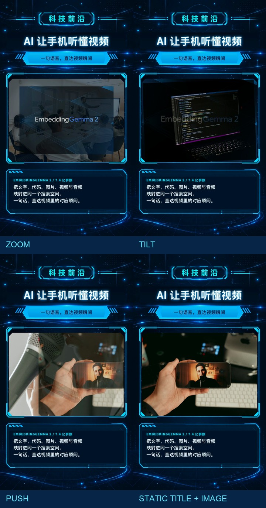

# AI News Image-Switch Brief — Vertical

**单条 AI 资讯图片快报：中央图片快速切换，使用 BGM，不含语音旁白。**

[▶ 查看完整样片](preview/full-sample.mp4) · [使用方法](USAGE.md) · [技术与素材](TOOLS.md) · [素材来源](SOURCES.md) · [Skill](SKILL.md)

<p align="center"></p>

## 适用场景

适合抖音、视频号、Shorts 等竖屏平台上的 AI 资讯、产品更新和科技知识快报。适合用 BGM 和快速切换的 4–8 张图建立节奏，同时保留标题、摘要和主体图片的清晰度。

模板采用 9:16 画幅。全息背景、标题区和摘要面板固定，中央画框是唯一切换的视觉区域；只使用随包的 `动态 bgm.mp3`，不含旁白和音效。

## 效果预览

| 完整样片 | 三种图片转场 |
| --- | --- |
| [播放或下载完整样片（MP4）](preview/full-sample.mp4) |  |

样片为 1080 × 1920、30 fps、约 18.3 秒。15.124 秒 BGM 会从头再播一次，第二段截取前 3.176 秒铺到片尾；中央画面按固定节拍切换。

## 内容结构

| 区域 | 内容 | 动效 |
| --- | --- | --- |
| 顶部标题 | 本期主题和一句副标题 | 静态保留，保证信息始终可读 |
| 中央全息画框 | 4–8 张资讯相关图片，可按节拍重复图片 | 放大、推入、旋转弹入按固定种子打乱，每次构建顺序可复现 |
| 底部摘要 | 关键事实或一句结论，最多三行 | 静态保留，与中央图片切换分离 |
| 音轨 | `动态 bgm.mp3` | 循环铺满 18.3 秒视频，不含语音播报和音效 |

## 快速开始

安装 Skill 时，把本模板完整目录复制到 ~/.codex/skills/ai-news-image-switch-brief/，或项目的 .agents/skills/ai-news-image-switch-brief/；不要只复制 SKILL.md。

在本目录执行：

```bash
npm run build
npm run check
npm run render -- --quality high --output out/my-ai-news.mp4
```

以上会直接构建并渲染随包的 EmbeddingGemma 2 示例，并输出完整封面 PNG 和播放页 HTML。更换标题、摘要、BGM、图片与节拍见 [`USAGE.md`](USAGE.md)；运行环境和素材说明见 [`TOOLS.md`](TOOLS.md) 与 [`SOURCES.md`](SOURCES.md)。

## 工程内容

- `templates/index.template.html`：全息背景、静态信息区和中央图片画框的 HyperFrames composition 模板。
- `data/sample-episode.json`：标题、摘要、音轨、图片及画面节拍示例。
- `scripts/build_episode.py`：校验内容和本地素材，并生成可运行的 `index.html`。
- `assets/`：随包示例背景、六张图片与指定 BGM；都可替换。
- `preview/`：真实渲染的封面、三种转场关键帧与完整样片。
- `USAGE.md`、`TOOLS.md`、`SOURCES.md`：替换、运行、依赖和素材来源说明。

## 许可

模板代码按本目录 [`LICENSE`](LICENSE) 中的 MIT 许可提供。指定 BGM、用户提供的全息背景图和第三方图片素材各有独立来源说明；代码许可证不替代媒体授权。再发布或商用前请查看 [`SOURCES.md`](SOURCES.md) 并确认权利范围。

## Skill 与交付脚本

SKILL.md 提供可安装的制作流程；scripts/new_project.py 创建干净工程副本；scripts/render_delivery.py 在渲染后导出完整首页封面 PNG 和播放页 HTML。
