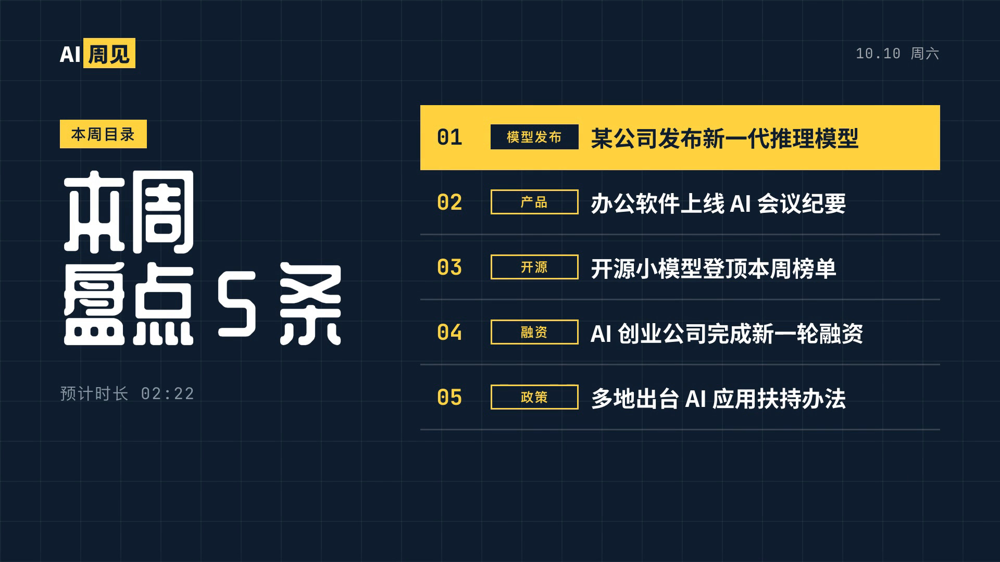
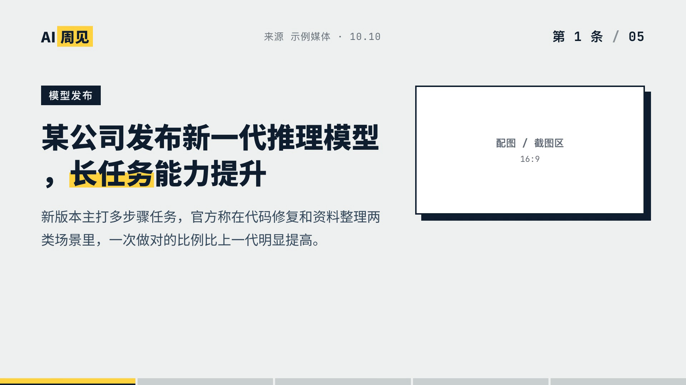
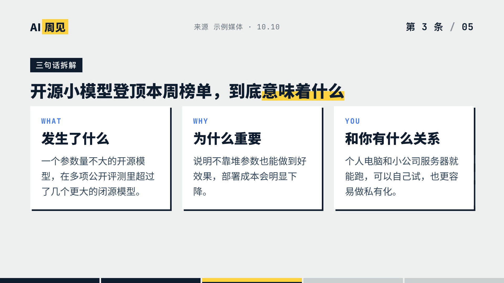
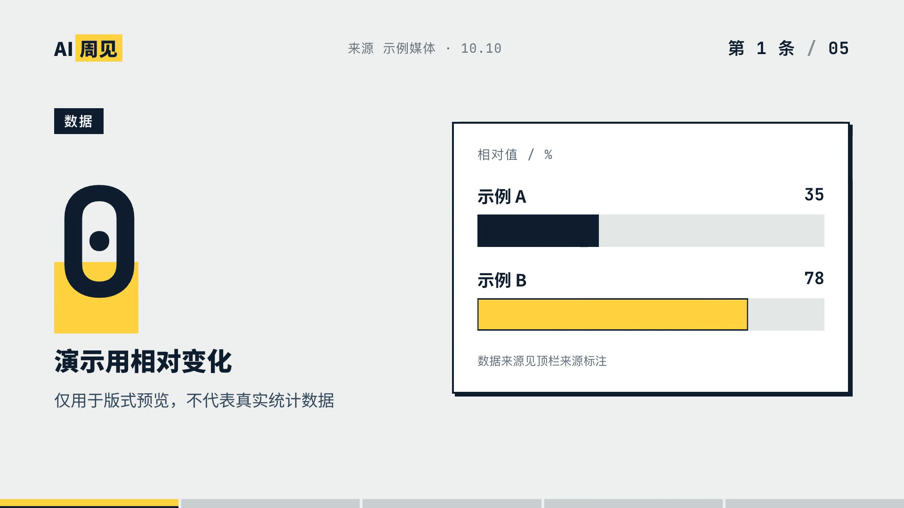

# AI Weekly News Roundup — Landscape

**AI 周见｜科技周报盘点｜横版** is a reusable 16:9 editorial video project for presenting several AI stories in one weekly episode. Its visual system pairs a dark blue grid opening, bright yellow highlights, clean story pages, optional data and explainer cards, and a short closing recap. The bundled HyperFrames project, page generators, fonts, animation library, and demo data make the sample buildable on another computer.

[▶ Watch the rendered demo](preview/full-sample.mp4) · [Usage](USAGE.md) · [Tools and licenses](TOOLS.md) · [Automation Skill](SKILL.md)


## Preview

| Contents page | Story page |
| --- | --- |
|  |  |

| Explainer card | Data comparison |
| --- | --- |
|  |  |

| Closing recap | |
| --- | --- |
|  | |

The demo copy is deliberately illustrative and includes no verified news claims, real news photographs, or narration. Treat it as layout data only; replace it with sourced reporting before publishing.

## When to use it

Use this template for a horizontal weekly AI and technology roundup, industry briefing, or research digest that combines several short stories with concise editorial commentary. A typical episode uses 3–10 stories, with optional data-comparison or three-point explainer pages inserted between stories.

The full program is 1920 × 1080 at 30 fps. An optional 1080 × 1920 cover composition is included for artwork experiments; the package does not provide a vertical video timeline.

## What is included

- A complete, locally buildable HyperFrames project and sample render.
- Seven page types: horizontal and vertical covers, contents, story, explainer, data comparison, and closing recap, plus a transition.
- Editable JSON data, Python page generators, a data-boundary check, bundled fonts, and GSAP.
- A Skill for turning a sourced weekly brief into the project, rendering an MP4, and exporting its complete opening cover as a separate PNG.
- Optional support for user-supplied narration WAVs. The package does not include a voice model, service credentials, or sample voice recordings.

## Quick start

Run these commands from this folder:

```bash
python3 scripts/build.py all --data data/sample-episode.json
python3 tests/edge_cases.py
npm run check
npm run render -- --output out/demo.mp4
python3 scripts/export_cover.py out/demo.mp4 --output out/demo-cover.png
```

The commands require Python 3, Node.js/npm, network access on the first HyperFrames CLI run, and the browser/FFmpeg dependencies described in [TOOLS.md](TOOLS.md). Step-by-step instructions are in [USAGE.md](USAGE.md).

## Project layout

```text
ai-weekly-news-roundup-landscape/
├── SKILL.md                 Natural-language production workflow
├── README.md                Template scope and rendered previews
├── USAGE.md                 Data editing, build, review, and delivery
├── TOOLS.md                 Dependencies and third-party licenses
├── SOURCES.md               Reporting and media attribution checklist
├── LICENSE                  License for template code
├── data/                    Clearly labeled illustrative episode data
├── templates/               Page layouts and animation source
├── scripts/                 Build, project-copy, and cover-export tools
├── compositions/            Generated HyperFrames compositions
├── standalone/              Generated pages for isolated review
├── assets/fonts/            Bundled fonts with license texts
├── assets/vendor/            Bundled GSAP runtime
├── assets/shots/             Empty drop-in folder for licensed images
├── preview/                  Rendered sample and key frames
├── tests/                    Episode-data edge checks
├── index.html                Complete sample timeline
└── hyperframes.json          HyperFrames project configuration
```

The template code is licensed under [MIT](LICENSE). Bundled fonts and GSAP retain their own terms; see [TOOLS.md](TOOLS.md) and `THIRD_PARTY_LICENSES/`.
