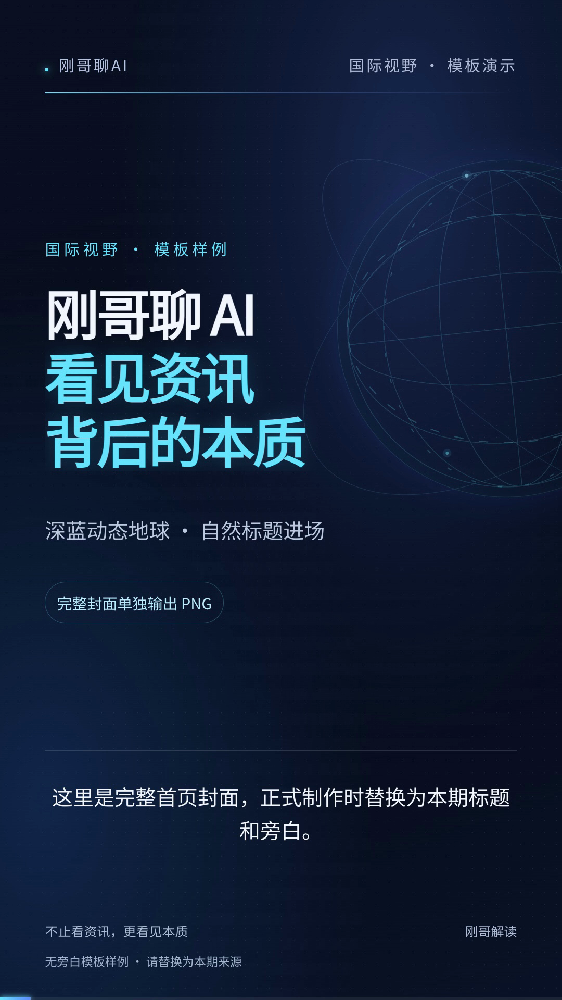

# Gangge AI International Vision — Vertical

“刚哥聊 AI｜国际视野”竖屏解读模板与可安装 Skill。深蓝动态地球、自然标题进场、同步字幕和完整六秒品牌片尾随工程提供；可从同一参考工程持续制作系列视频。



[完整样片：18.9 秒，无旁白、有音效](preview/full-sample.mp4) · [使用说明](USAGE.md) · [工具与配置](TOOLS.md) · [Skill 入口](SKILL.md)

## 适用场景

AI 资讯、国际科技与商业议题、单条新闻拆解、行业趋势解读。保持栏目视觉，替换标题、正文、来源和旁白；无需数字人或生成图片。

## 规格与包含内容

1080×1920，30fps，H.264/AAC。包含 Skill、可复制的 HyperFrames 工程、动态地球、原 v3 标题进场、品牌 Logo、翻页与片尾音效、GSAP 3.14.2、Noto 中文字体、分段配音入口及导出脚本。

正式交付同时输出 MP4、完整首页封面 PNG、poster 播放页和字幕。封面从视频0.7秒处提取完整首页，保持视频开场动效。示例是静音旁白轨加音效，不包含“国标视野”样音；真实旁白需自行提供或配置 TTS。

## 三步试运行

先准备 Node.js 22+ / npm、Python 3、FFmpeg/FFprobe 和可用浏览器；从本目录执行：

```sh
npm run compose
npm run check
npm run render -- --allow-demo
```

视频、完整封面和播放页在 `out/`。第一次 npx 下载固定 HyperFrames 0.8.133；工具本身的网络、账号或额度要求仍适用。

## 作为 Skill 使用

将本目录完整复制为 `~/.codex/skills/gangge-ai-international-vision/` 或项目的 `.agents/skills/gangge-ai-international-vision/`，新开会话后提供内容并说：“用刚哥聊 AI 国际视野生成一个视频。”必须连同 `assets/template-project/` 一起安装，不能只复制 SKILL.md。

源工程在 [assets/template-project](assets/template-project/README.md)，详细改稿/配音步骤在 [USAGE.md](USAGE.md)。源码沿用仓库 MIT；第三方文件保留原许可，见 [TOOLS.md](TOOLS.md)。品牌 Logo 和音效经用户明确允许进入公开仓库，使用品牌标识不代表获得商标背书。
