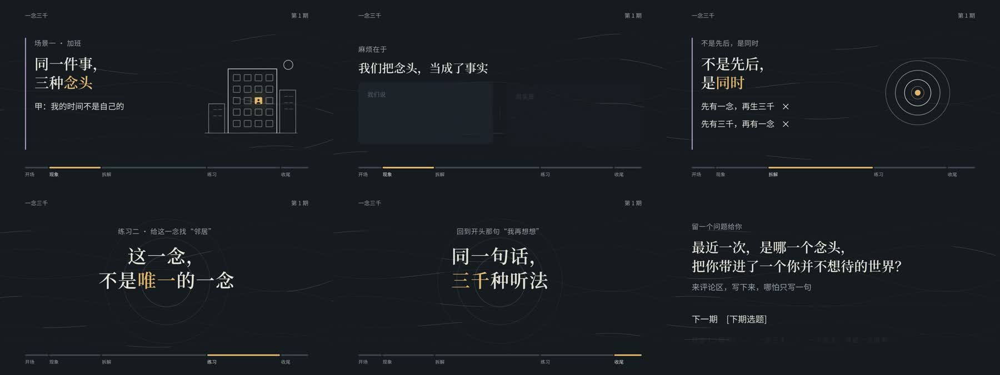

# Concept Explainer — Landscape

**一念三千｜日常观念讲解｜横版** is a reusable 16:9 explainer template for turning an abstract idea into relatable situations, visual comparisons, a clear explanation, and practical takeaways. The included episode demonstrates the format with the idea “一念三千”.

[▶ Watch the rendered sample](preview/full-sample.mp4) · [Usage](USAGE.md) · [Tools and licenses](TOOLS.md) · [Production Skill](SKILL.md)


## Preview



## When to use it

Use this template for long-form educational videos about philosophy, psychology, culture, or everyday ways of thinking. Its 51-page structure moves from a concrete opening example through daily-life scenarios, a concept breakdown, practical exercises, a recap, and a short branded outro. Replace the Chinese demo narration and text in the structured episode data for a new topic.

The bundled sample is 1920 × 1080 at 30 fps and about 12 minutes 55 seconds. The repository preview is a compressed 1280 × 720 copy.

## Included

- Buildable HyperFrames project and editable JSON episode data.
- 51 animated pages, original SVG illustration source, cover art, and series outro.
- Noto Sans SC and Noto Serif SC variable fonts with OFL texts; GSAP 3.15.0.
- Bundled narration WAVs and manifest for rebuilding this episode; optional generic VoiceStudio-compatible generation script.
- Rendered sample, opening cover, and selected-frame contact sheet.

The voice profile and local endpoint are not stored. New narration needs a user-configured service and voice. The sample WAVs and video are demo media; see [SOURCES.md](SOURCES.md) before redistributing or adapting them.

## Quick start

From this folder, with Node.js/npm and Python 3 installed:

```bash
npm run build
npm run check
npm run render
```

The rendered output goes to `out/demo.mp4`. See [USAGE.md](USAGE.md) for editing the episode data, regenerating narration, previewing, and troubleshooting.

## Project layout

```text
idea-explainer-landscape/
├── README.md, USAGE.md, TOOLS.md, SOURCES.md, SKILL.md
├── LICENSE                  MIT for original template code only
├── data/sample-episode.json Editable episode data
├── source/                  Composition builder and SVG illustrations
├── scripts/                 Build, audio integration, optional narration generation
├── assets/audio/            Bundled sample narration WAVs
├── compositions/            Generated outro composition
├── fonts/                   Noto fonts and OFL texts
├── vendor/                  GSAP and cover background
├── preview/                 Rendered sample and review images
├── index.html               Built HyperFrames composition
└── hyperframes.json         HyperFrames configuration
```

The MIT license covers original template code only. Bundled fonts, GSAP, sample episode text, artwork, and audio retain their respective rights and terms; see [TOOLS.md](TOOLS.md) and [SOURCES.md](SOURCES.md).
