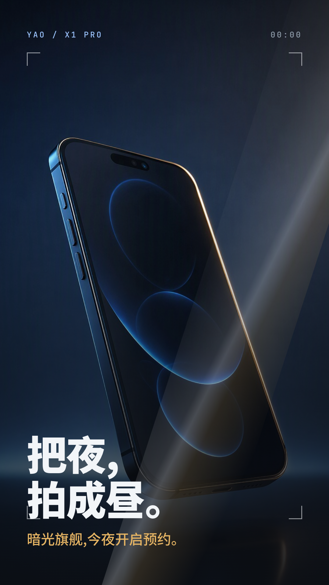

# Tech Product Promo — Vertical

一套用于手机、硬件、SaaS 等产品发布与促销的**竖屏科技 Promo 模板**。工程固定六页节奏与一套完整的深色高级感视觉系统:石墨蓝渐变底、双强调色分工(冷色=技术/数据,暖色=情绪/行动号召)、以及签名元素"掠光取景框"(四角取景括号框住主角 + 一道尾缘带暖金的掠光扫过)。替换文案、产品图与品牌色即可产出自己的发布短片。



## 适用场景

- 手机、耳机、穿戴等消费硬件的发布预告、促销短片与电商主图视频。
- SaaS / AI 产品的 feature reveal、版本发布与官网首页竖屏宣传。
- 社交媒体竖屏投放(抖音、视频号、小红书、Shorts),需要"开场即起势"的快节奏产品片。
- 有明确卖点清单(1 个主卖点 + 若干规格 + 1 个头条数字)的产品内容。

模板为 9:16 竖屏、约 26.5 秒、六页固定节奏;视觉走"深色高级感 + 克制强调色"路线,不适合口播讲解、长教程或浅色清新风格的内容。

## 效果预览

| 完整样片 | 六页画面总览 |
| --- | --- |
| [播放或下载完整样片(MP4)](preview/full-sample.mp4) | [查看六页关键画面](preview/contact-sheet.jpg) |

样片为 1080 × 1920 竖屏、30 fps、约 26.5 秒,含电子氛围配乐(带鼓点推进感)、无旁白。分页画面见 [`preview/keyframes/`](preview/keyframes/)。

## 内容结构

| 页 | 时间 | 内容 | 关键动效 |
| --- | --- | --- | --- |
| 封面 | 0–3.5s | 产品全屏 + 取景括号 + 两行主标题 + 暖金收益行 | 产品 Ken Burns 慢推;标题逐行入场;掠光一次 |
| 卖点特写 | 3.5–8s | 微距图上屏 + 冷色功能标题 + 规格 chips | 微距 perspective tilt + 慢推;chips 错峰弹入 |
| 参数规格 | 8–13.5s | 等宽键 + 大值 + 冷色进度条 | 行自左错峰;进度条 scaleX 展开 |
| 大数字 | 13.5–17s | 超大头条数字 + 一行标签 | 数字 scale 入场;冷色光晕 |
| 情绪场景 | 17–22s | 暖调 + 出血底纹字 + 人文文案 | 黑场溶解;底纹字慢移 |
| 结尾 CTA | 22–26.5s | 品牌锁定 + 暖金胶囊 + 发售日期 | 胶囊弹入;掠光收束全片 |

## 快速开始

```bash
python3 fill.py content.example.json out/
cd out
npm install
npm run check
npm run dev  # 预览后按 Ctrl+C 停止
mkdir -p ../deliver
npm run render -- --quality high --output ../deliver/product-promo.mp4
ffmpeg -y -ss 0.5 -i ../deliver/product-promo.mp4 -frames:v 1 -update 1 ../deliver/cover.png
```

以上直接渲染随包示例(虚构品牌"曜 YAO X1 Pro")。替换自己的内容、检查画面和音轨以及核验成片后，再按 UniStudio 流程执行 `ready` 登记。内容字段见 [`USAGE.md`](USAGE.md);框架、工具版本与素材授权见 [`TOOLS.md`](TOOLS.md) 和 [`SOURCES.md`](SOURCES.md)。

## 工程内容

- `index.html`:可运行的示例合成——六页 clip、主时间轴动画、根级配乐轨与全部页面样式。
- `templates/index.template.html`:令牌化模板(`{{TOKEN}}` 占位),配合 `fill.py` 批量换内容。
- `fill.py` + `content.example.json`:填充脚本与示例内容字段;缺令牌或残留占位符会报错,不会渲出半成品。
- `SKILL.md`:面向 UniStudio AI 的制作步骤与内容核验要求。
- `assets/`:`hero.jpg`(封面产品图)、`macro.jpg`(卖点微距图)、`bgm.mp3`(默认配乐),均可替换。
- `preview/`:样片、封面、六页总览与分页关键帧。
- `USAGE.md`、`TOOLS.md`:使用步骤及工具与素材依赖说明。
- `SOURCES.md`、`LICENSE`、`THIRD_PARTY_LICENSES/`:素材来源、代码许可和第三方许可。

## 许可

模板源码采用本目录 [`LICENSE`](LICENSE) 中的 MIT 许可。GSAP 经 CDN 引入,使用前查看 [`THIRD_PARTY_LICENSES/GSAP-Standard-License.md`](THIRD_PARTY_LICENSES/GSAP-Standard-License.md);字体按 SIL OFL 许可,见 [`THIRD_PARTY_LICENSES/FONTS.md`](THIRD_PARTY_LICENSES/FONTS.md);配乐来自 Mixkit,见 [`THIRD_PARTY_LICENSES/MIXKIT.md`](THIRD_PARTY_LICENSES/MIXKIT.md)。示例产品图为 AI 生成的虚构品牌占位素材，其他来源与使用范围见 [`SOURCES.md`](SOURCES.md)。
